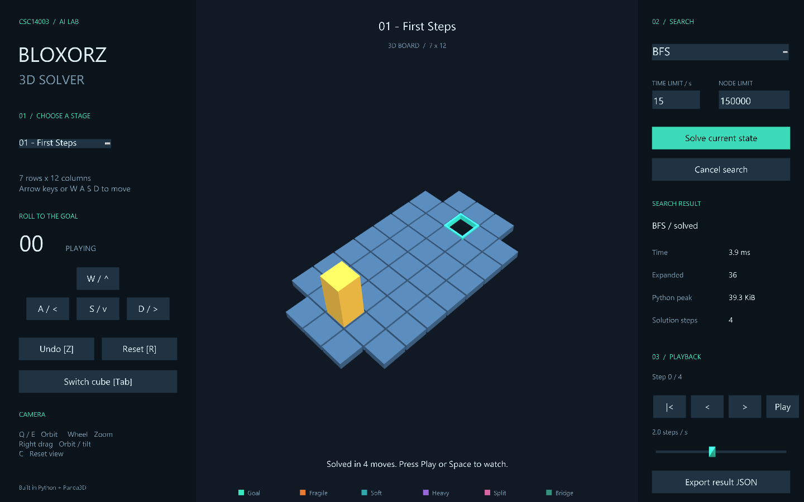

# Bloxorz — 3D Solver Lab

GUI 3D bằng **Panda3D**, tích hợp một engine dùng chung cho chơi tay, tìm kiếm và phát lại lời giải. Geometry được tạo trong Python, không cần tải model/texture.



## Chạy ứng dụng

Đã kiểm chứng trên Windows với Python 3.12 và Panda3D 1.10.16. Cần môi trường desktop có driver đồ họa hỗ trợ OpenGL. Có thể chạy trên Linux/macOS có Panda3D tương ứng; kiểm thử đồ họa hiện được thực hiện trên Windows.

```powershell
python -m venv .venv
.venv\Scripts\python -m pip install -r requirements.txt
.venv\Scripts\python main.py
```

Linux/macOS: dùng `.venv/bin/python` thay cho `.venv\Scripts\python`.

Level khác và ảnh chụp không mở cửa sổ:

```powershell
python main.py --level levels/05_split.json
python main.py --screenshot artifacts/preview.png
```

## Chức năng

- Bàn chơi và block 3D thật, ánh sáng, hoạt ảnh lăn 90 độ, hoạt ảnh rơi, xoay/zoom camera.
- Năm level mẫu: nền thường, đường hẹp, ô yếu, cầu/công tắc và tách/gộp block; tất cả đã được BFS chứng minh có nghiệm.
- Chơi tay, chọn khối con, undo và reset; khi rơi giữ trạng thái hợp lệ cuối để undo.
- Chọn BFS, DFS, UCS, A*; tìm từ **trạng thái đang chơi**, giới hạn thời gian/node và hủy tìm kiếm.
- Solver chạy trong tiến trình `spawn` riêng, GUI vẫn xử lý input/camera; tự dọn worker khi hủy, đổi màn hoặc đóng ứng dụng.
- Thống kê, playback play/pause, bước trước/sau, về đầu và thay đổi tốc độ.
- Xuất kết quả kèm board, actions, states và metrics vào `exports/last_result.json`.

| Điều khiển | Tác dụng |
| --- | --- |
| Mũi tên / W A S D | Di chuyển theo hàng/cột của board; xoay camera không đổi hệ hướng |
| Tab | Chọn khối con khi tách đôi |
| Z / R | Undo / reset |
| Enter / Esc | Tìm lời giải / hủy tìm kiếm và dừng playback |
| Space | Play/pause lời giải |
| Q / E, kéo chuột phải | Xoay camera, kéo dọc để đổi góc nhìn |
| Cuộn chuột / C | Zoom / khôi phục camera |

GUI cũng có nút bấm cho các thao tác chính. Khi chỉnh ô nhập, hotkey chơi game được tạm ngưng.

## Cấu trúc và ranh giới module

```text
main.py                    CLI + entry point có guard Windows spawn
gui/app.py                 Vòng lặp và bảng điều khiển Panda3D
gui/scene.py               Cảnh 3D, camera, rolling/falling animation
gui/geometry.py            Mesh nguyên bản tạo bằng code
integration/session.py     State ván chơi, selection, undo/reset
integration/search_problem.py  Adapter từ Board/rules đến SearchProblem
integration/solver_runner.py   Worker, timeout, cancellation, lỗi
integration/playback.py    Timeline lời giải và kiểm tra chuyển trạng thái
core/                     Model level/state, enums và luật chơi
solvers/                  Contract kết quả và BFS/DFS/UCS/A*
levels/                   Dữ liệu màn chơi JSON
tests/                    Core, solver, integration và graphics smoke test
```

`core.rules.apply_action(board, state, action)` trả `State` mới hoặc `None` nếu bước đi không hợp lệ. `is_goal` kiểm tra đứng nguyên khối trên ô đích; `successors` sinh cặp `(Action, State)` hợp lệ. Renderer chỉ đọc model; manual play, solver và playback đều gọi cùng bộ luật.

`SearchProblem` nhận `initial_state`, `is_goal`, `successors`; `Transition` chứa `Action` và `State` kế tiếp. Các solver trả `SearchResult` chung: `algorithm`, `status`, `actions`, `states`, `metrics`. `states` gồm cả điểm đầu và đích; khi giải được có `len(states) == len(actions)+1`.

Status gồm `solved`, `unsolvable`, `timeout`, `node_limit`, `cancelled`. Lỗi worker được báo riêng trên GUI. `expanded_nodes` tính các state thực sự bắt đầu mở rộng, không tính goal. Thời gian lưu bằng giây và hiển thị ms; bộ nhớ là đỉnh allocation Python do `tracemalloc` đo trong worker, **không phải tổng RAM tiến trình**. Mỗi bước có cost 1; BFS/UCS tìm lời giải ít bước nhất, DFS không đảm bảo ngắn nhất.

**A* hiện dùng heuristic 0 theo mặc định**, an toàn cả với teleport/split và tương đương UCS về thứ tự ưu tiên. Solver có thể nhận custom heuristic `State -> float`; việc thêm heuristic Bloxorz có chứng minh admissible là phần mở rộng cho người phụ trách thuật toán. GUI không hiển thị các heuristic chưa được triển khai. Chưa có trực quan hóa toàn bộ cây tìm kiếm; playback hiển thị đường lời giải.

## Quy ước level và luật đặc biệt

`Board.from_json()` hỗ trợ grid ASCII: `#` vực, `.` sàn, `S` điểm đầu, `G` đích, `F` ô yếu, `o` soft switch, `x` heavy switch, `(` split switch, `B` cầu. Cần khai báo `switches`, `split_switches` và `initial_bridges` khi dùng các loại ô tương ứng; xem `levels/04_switch.json`, `levels/05_split.json`.

- Soft switch kích hoạt khi vừa được đè; heavy/split switch yêu cầu block nguyên khối đứng thẳng.
- Switch không bị kích hoạt lại chỉ vì khối con khác di chuyển trong khi một khối vẫn nằm trên nó.
- `TOGGLE` đảo cầu, `PERMANENT_OPEN/CLOSE` là thao tác đặt cầu mở/đóng. Chúng không tạo khóa toàn cục ngăn switch khác thay đổi cùng cầu. Nếu nhiều switch cùng kích hoạt, xử lý theo tọa độ.
- Cầu hoạt động lấy từ `State.active_bridges`, không phải dữ liệu ban đầu của Board. Kiểm tra support sau tác động switch để phát hiện cầu sập.
- Split teleport hai cube đến vị trí cấu hình; chúng tự gộp khi kề cạnh. GUI giữ selection bằng tọa độ để tránh đổi nhầm cube sau khi State sắp xếp vị trí.
- Thử bước không hợp lệ dẫn tới thua và tính một lần di chuyển; Undo khôi phục cả state, bộ đếm và selection.
- Nạp lời giải bắt đầu timeline riêng tại state đã gửi solver. Lịch sử manual trước thời điểm đó không thuộc timeline playback; Reset luôn trở về đầu level.

## Kiểm thử

```powershell
python -m pip install -r requirements-dev.txt
python -m pytest -q -W error
```

Kiểm thử đồ họa thật tạo context offscreen, render PNG, nhập phím, chơi/undo, chạy worker, playback, rơi và tách khối:

```powershell
$env:BLOXORZ_TEST_GRAPHICS="1"
python -m pytest tests/test_gui_3d.py -q -W error --basetemp=artifacts/pytest-gui
```

Linux/macOS: `BLOXORZ_TEST_GRAPHICS=1 python -m pytest tests/test_gui_3d.py -q`. Context offscreen vẫn cần graphics driver/display backend phù hợp. CI chạy kiểm thử core/solver/integration trên Windows và Ubuntu; graphics test là opt-in.

## Ghi nhận và phạm vi tích hợp

Model kế thừa `main` của nhóm; BFS/DFS bắt đầu từ nhánh `feature/bfs-dfs`. Phần này bổ sung `rules.py` còn trống và sửa helper import/invariant để GUI có thể chạy xuyên suốt; cần người phụ trách core review semantics trước khi merge. UCS/A* dùng contract chung, không ghép nguyên nhánh AIMA đang thiếu module.

Tham khảo cách tổ chức menu và playback từ [Erroler/Bloxorz](https://github.com/Erroler/Bloxorz). GUI, procedural meshes và lớp tích hợp trong bản này được triển khai riêng cho model của nhóm.

Nên review bằng pull request của nhánh `feature/gui-3d-integration` vào `main`, chạy checks và đối chiếu luật với yêu cầu đồ án trước khi merge.
